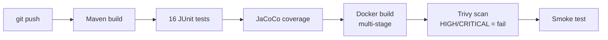

# devops-demo — CI/CD pipeline for a Java application

A small Java 21 / Maven project used as a sandbox to build a **complete CI pipeline**: compile → unit tests → coverage → Docker image → vulnerability scan → smoke test. The same pipeline is implemented twice: with **Jenkins** and with **GitHub Actions**.


## Pipeline



| Stage | Tool | What it checks |
|---|---|---|
| Build | Maven | The code compiles with Java 21 |
| Unit tests | JUnit 4 | 16 tests on `add`, `multiply`, `factorial`, `isEven`, `max` (incl. edge cases and exceptions) |
| Coverage | JaCoCo | Report in `target/site/jacoco/index.html` |
| Container | Docker | Multi-stage image: Maven build stage, JRE-only runtime, non-root user |
| Security | Trivy | Blocks the pipeline on fixable HIGH/CRITICAL vulnerabilities |
| Smoke test | Docker | The container starts and prints the expected output |

## Run locally

```bash
mvn clean verify                       # build + tests + coverage
java -jar target/devops-demo-1.0-SNAPSHOT.jar

docker build -t devops-demo .
docker run --rm devops-demo            # → Hello DevOps CI!
```

## Jenkins setup

1. Install the plugins *Pipeline*, *Git*, *JUnit* and *Docker Pipeline*.
2. Configure a Maven installation named `M2_HOME` (*Manage Jenkins → Tools*).
3. Create a *Pipeline* job → *Pipeline script from SCM* → this repository → `Jenkinsfile`.

## Project structure

```
├── src/main/java/tn/esprit/App.java      # application
├── src/test/java/tn/esprit/AppTest.java  # unit tests
├── pom.xml                               # Maven + JaCoCo
├── Dockerfile                            # multi-stage image
├── Jenkinsfile                           # Jenkins pipeline
└── .github/workflows/ci.yml              # GitHub Actions pipeline
```

---
**Malek Ayadi** · [LinkedIn](https://www.linkedin.com/in/malek-ayadi) · [GitHub](https://github.com/malekayadi79)
